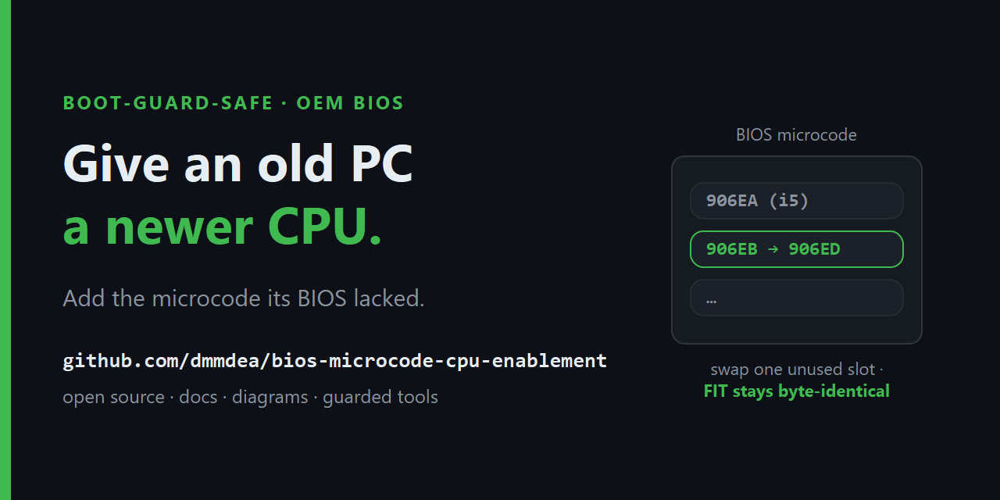
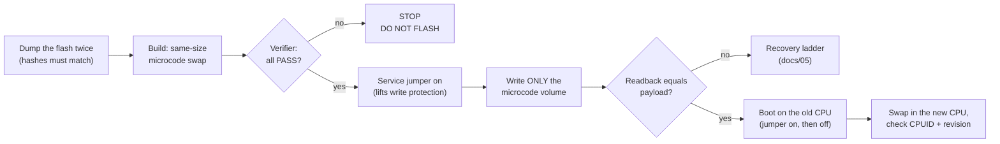

<!--
Keywords: add CPU microcode to BIOS, OEM BIOS microcode injection, run a 9th gen Intel CPU on an 8th gen
OEM motherboard, Coffee Lake Refresh on 300-series chipset, Dell OptiPlex 7060 i7-9700T BIOS mod,
Boot Guard safe microcode mod, Intel FIT microcode slot swap, FPT Error 167 Protected Range Registers,
service mode jumper, extend the life of an end-of-life PC, reduce e-waste, upgrade a retired business PC.
-->

# Give an old OEM PC a newer CPU by adding the microcode its BIOS lacks



**Some OEM business PCs can electrically run a CPU from the next Intel generation, but their final BIOS
never shipped that CPU's microcode, and without it the CPU is reported not to start. This repo documents how to copy
that microcode from the same vendor's BIOS for a sibling model into your own BIOS image without touching
anything Intel Boot Guard verifies, and ships two offline tools: one builds the image, the other refuses
to pass it unless every safety check holds.**

> [!WARNING]
> This rewrites part of your motherboard's firmware. A bad write to the SPI flash can leave a board that
> only an external programmer can recover. The method and tools make that much less likely than the forum
> guides they replace, but they cannot make it zero. Read
> [docs/05-safety-and-recovery.md](docs/05-safety-and-recovery.md) before you start, and do nothing until
> you hold two identical backups of your flash.

## In short

| | |
|---|---|
| **Problem** | An OEM board's final BIOS carries microcode only for the CPUs the vendor validated for that model. Forum reports say a newer CPU it never validated will not POST, even when the chipset supports it. |
| **Source of the fix** | The same vendor often sold a sibling board that *was* validated for the newer CPU. Its BIOS contains the exact Intel-signed microcode that CPU needs. |
| **Method** | Overwrite one microcode slot your machine does not use (a CPU stepping you do not have) with the donor microcode of exactly the same size. The Firmware Interface Table stays byte-identical, the current CPU's microcode stays as a fallback, and nothing inside the Boot Guard-hashed region changes. Write only the microcode volume back. |
| **Safety net** | `verify_microcode_mod.py` parses the Boot Policy Manifest from your own image, recomputes the Boot Guard digest, and prints `DO NOT FLASH` if any byte changed outside the microcode volume, the FIT moved, the fallback is gone, or a checksum fails. |
| **Proven on** | Dell OptiPlex 7060 SFF, BIOS 1.32.0: an i5-8500 (6 cores, 65 W) replaced by an i7-9700T (8 cores, 35 W) using 906ED microcode from the OptiPlex 7070 BIOS 1.35.0. Running since August 2026. Other boards are candidates, not proven ([docs/02](docs/02-does-my-hardware-qualify.md)). |

## The flow



## Quick start (offline, nothing touches hardware)

```sh
# 1. Build the modified image from YOUR dump and a donor BIOS (placeholders shown)
python -I tools/build_microcode_swap.py dump_before.bin donor_bios_region.bin 906ED \
    --replace-cpuid 906EB --fallback-cpuid 906EA --out-dir out

# 2. Independently verify it before any write
python -I tools/verify_microcode_mod.py dump_before.bin out/modified_full.bin out/ucode_fv_mod.bin \
    --target-cpuid 906ED --fallback-cpuid 906EA --replace-cpuid 906EB
```

Both tools use only the Python standard library, read the files you name, and never open a device. The
write itself is a separate, manual step with Intel's flash tool, covered with every precondition in
[docs/04-procedure.md](docs/04-procedure.md).

## How the tools were tested

Against the reference build's real files (kept private; they identify the machine):

- The verifier passes the image that was actually flashed, and derives the four Boot Guard IBB segments
  (0xF6000 bytes) from the image's own Boot Policy Manifest rather than from a hard-coded table.
- Six damaged copies (one byte flipped inside the IBB, the FIT, the Boot Policy Manifest, the ME region
  or an unrelated BIOS area, and a zeroed fallback microcode) all fail with `DO NOT FLASH`.
- Given the pre-modification dump and a donor, the builder reproduces the flashed image and the
  flashed payload **byte for byte**, from a full SPI dump, from a BIOS-region dump, and from a bare
  microcode file.
- The builder refuses, and writes nothing, when the target microcode is already present, the fallback
  or the slot to replace is missing, the slot to replace is a fallback, or the donor fails Intel's checksum.
- Built-in self-tests on synthetic images: 31 cases (verifier) and 24 cases (builder).

Run `python -I tools/verify_microcode_mod.py --self-test` and the same for the builder to repeat the last point.

## Who did what on the reference build

All the firmware work ran remotely over SSH, done by an AI coding agent: reading the flash, the
Boot Guard analysis, building and verifying the image, the write and the readback. The owner's part was
physical: moving the service jumper and swapping the CPU and thermal pad. The docs are written so a
careful person or a capable agent can follow them, with the physical steps marked.

## Does my hardware qualify?

You need an OEM board whose chipset already supports the newer CPU, a sibling board from the same vendor
whose BIOS ships the microcode, a way to lift flash write protection (usually a service jumper), and a
retail CPU (not an engineering or qualification sample). The checks you can run first without writing
anything, the decision tree and the candidate list are in
[docs/02-does-my-hardware-qualify.md](docs/02-does-my-hardware-qualify.md).

Out of scope: 100/200-series boards that need pin modifications for a newer CPU, AMD platforms, and
laptops with soldered CPUs.

## Documentation

| Doc | What it covers |
|---|---|
| [01 Background](docs/01-background.md) | Why keeping these PCs running matters now, with the numbers |
| [02 Does my hardware qualify?](docs/02-does-my-hardware-qualify.md) | First checks, decision tree, candidate boards |
| [03 How it works](docs/03-how-it-works.md) | Microcode, the FIT, Boot Guard, and why this edit stays outside it |
| [04 Procedure](docs/04-procedure.md) | The runbook, phase by phase, with gates |
| [05 Safety and recovery](docs/05-safety-and-recovery.md) | What bricks a board and the recovery ladder |
| [06 Reference build](docs/06-reference-build.md) | The OptiPlex 7060 SFF, end to end |
| [07 FAQ](docs/07-faq.md) · [08 Glossary](docs/08-glossary.md) | Short answers and terms |
| [09 Sourcing and licensing](docs/09-sourcing-and-licensing.md) | Where each input comes from, and why none ships here |
| [tools/](tools/) | The builder and the verifier |

## Why bother

Making a computer accounts for most of its lifetime carbon (about 70-80% in the makers' own studies),
and under a quarter of the world's e-waste is properly recycled (UN Global E-waste Monitor 2024, 2022
data). Memory prices roughly doubled in early 2026 and Gartner expects PC prices to rise about 17% this
year. A used CPU and an afternoon can keep a working machine in service for years. Sources and detail:
[docs/01-background.md](docs/01-background.md).

## What this repo does not contain

No vendor BIOS, no microcode binaries, no flashing tool. The BIOS comes from the vendor's support site
and the microcode from that BIOS (or Intel's public microcode repository). Intel's flash tool is an
OEM tool with no official public download; [docs/09](docs/09-sourcing-and-licensing.md) covers how to
check a copy before you trust it.

## Credits

This builds on years of community firmware work: the Win-Raid microcode and OEM BIOS threads, platomav's
MCExtractor, LongSoft's UEFITool, and the coreboot and flashrom projects. What it adds is a Boot
Guard-aware, same-size swap with a verifier that parses each image's own manifests and prints
`DO NOT FLASH` when an image is unsafe.

## License and trademarks

Code: MIT, no warranty. Docs and images: CC BY 4.0 (see [LICENSE](LICENSE)). Modifying firmware is your decision and your risk. Intel, Boot Guard, Dell, OptiPlex,
HP and Lenovo are trademarks of their owners, used here only to describe hardware; this project is not
affiliated with or endorsed by any of them. Report a board that worked or failed with the
[hardware report template](.github/ISSUE_TEMPLATE/hardware-report.md).
