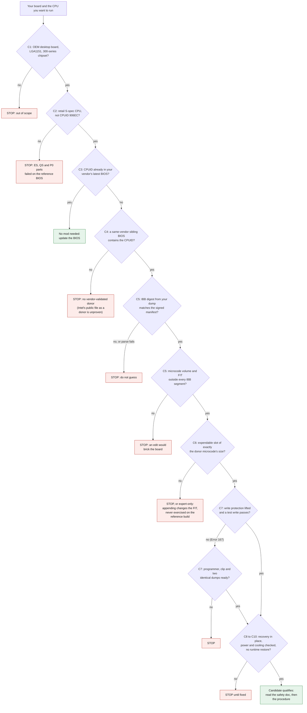

# Which hardware qualifies

*Last reviewed 2026-10-11. Vendor pages, tool versions and links change, so check them again before you rely on them.*

This method adds one CPU microcode patch to the BIOS of your own, out-of-warranty OEM desktop. It works only when that patch is the single thing missing, and it has been run end to end on one machine. Four conditions have to hold together:

- **Board.** An OEM desktop board (the system board of a branded prebuilt, whose BIOS only the PC vendor ships) with socket LGA1151 and a 300-series chipset. The hardware already runs the newer CPU generation; the BIOS has no microcode for it.
- **Donor.** A sibling board from the same vendor officially supports your CPU and ships its microcode in a public BIOS update.
- **Write access.** You can lift the firmware's write protection for the duration of the write, usually with an OEM service jumper, or you can program the flash chip externally.
- **CPU.** A retail processor of a stepping the BIOS accepts (R0, CPUID 906ED, on the reference build). Engineering and qualification samples failed in every report found.

If one of these fails, stop. Most of the answer is available from a desk without writing anything, so run the checks in the next section before you buy a CPU or open the case.

Claims are labelled with the evidence words defined in [03](03-how-it-works.md#how-to-read-the-evidence): verified on the reference build ([the Dell OptiPlex 7060 SFF](06-reference-build.md) this project was developed on), reported, inferred and unconfirmed. Forum and vendor sources are linked under [Sources](#sources). The status words in the families table (PROVEN, REPORTED and so on) are a separate scale, defined there.

## Check this first

Three of the four conditions can be tested without writing a byte: the board, the CPU and the donor. Work through these in order.

### 1. Identify the board, the BIOS and the CPU

Windows, in PowerShell:

```powershell
Get-CimInstance Win32_BaseBoard | Select-Object Manufacturer, Product
Get-CimInstance Win32_BIOS      | Select-Object SMBIOSBIOSVersion, ReleaseDate
Get-CimInstance Win32_Processor | Select-Object Name, ProcessorId
```

Linux:

```sh
sudo dmidecode -t baseboard | grep -E 'Manufacturer|Product Name'
sudo dmidecode -s bios-version
grep -m5 -E '^(cpu family|model|stepping|microcode)' /proc/cpuinfo
```

Note the form factor (SFF, Micro, Tower) as well as the model. One model name can cover boards with different jumper layouts and different power limits.

### 2. List the microcode your board can load

Two listings answer two different questions. The vendor's newest BIOS shows what an update would give you. A dump of your own chip shows what the board holds now.

**The vendor's latest BIOS.** No special tools.

1. Download the latest BIOS update for your exact model from the vendor's support site. Do not run it.
2. Unpack it into a raw BIOS image. For Dell packages, the Dell PFS update extractor in BIOSUtilities does this [13].
3. List the microcode with MCExtractor [12]:

```sh
pip3 install colorama pltable
python MCE.py bios_image.bin
```

MCExtractor needs its `MCE.db` file next to `MCE.py`; the release ships both. It prints one row per microcode with CPUID, platform mask, revision, date, size and checksum. A 2018 Win-Raid thread recommends it for exactly this question, whether a BIOS carries a given CPU [10].

Do not use the vendor's installer as the extractor. On the reference build, Dell's installer run over a remote connection with the switches Dell's recovery article lists [20] answered "Unrecognized option", dropped the connection and rebooted the machine ([06](06-reference-build.md#what-went-wrong-along-the-way)). Unpack the package with a tool instead of executing it.

**Your own chip.** Intel's Flash Programming Tool (FPT) can read the BIOS region for listing. Use only the read commands here:

```text
fptw64 -i
fptw64 -d bios_a.bin -bios
fptw64 -d bios_b.bin -bios
```

`-i` prints the flash chip and region layout. `-d ... -bios` reads the BIOS region into a file. Take it twice and compare:

```powershell
Get-FileHash -Algorithm SHA256 bios_a.bin, bios_b.bin
```

The two hashes must match. Then run MCExtractor on `bios_a.bin`. These `-bios` files are for listing only: a BIOS-region file has no descriptor, GbE or ME region and cannot restore a board. The pre-write backup is the whole-chip dump taken with `-d` and no region switch ([the procedure](04-procedure.md), Phase 0.5; [safety and recovery](05-safety-and-recovery.md), section 1).

The FPT build matters, and which builds start differs once the service jumper is set: the [reference build](06-reference-build.md) has the table. Intel gives FPT to OEMs, so this repo does not redistribute it; sourcing is in [sourcing and licensing](09-sourcing-and-licensing.md).

Keep every dump on your own storage. A dump of a real chip may contain machine-specific data such as the service tag, so do not attach one to an issue.

### 3. Work out the CPUID your CPU needs

Microcode is matched to a CPUID, the processor signature. The CPUID follows from the stepping (the silicon revision: U0, B0, P0, R0), and the stepping follows from the sSpec printed on the CPU's lid.

Read the lid. A retail Intel part's sSpec starts with S; the i7-9700T on the reference build is SRG17. The pre-production codes on record start with Q (QQZ6, QRNL, QN8H), and some parts are marked INTEL CONFIDENTIAL. Read it before you buy and again before you flash, because a seller's listing is not the lid. Then look the sSpec up in Intel's ARK (under Ordering and Compliance) or another sSpec database, note the stepping, and match it here:

| CPUID | Stepping | Intel file name | What it is | On the reference BIOS (1.32.0) |
|---|---|---|---|---|
| 906EA | U0 | 06-9e-0a | 8th-gen 6-core | Present, revision F8 |
| 906EB | B0 | 06-9e-0b | 8th-gen 4-core | Present, revision F6 |
| 906EC | P0 | 06-9e-0c | First 9th-gen 8-core stepping; ES and QS parts | Not present, and the BIOS blocks the stepping in code [5] |
| 906ED | R0 | 06-9e-0d | Retail 9th-gen 8-core, for example i7-9700T (SRG17) and i9-9900T (SRG1B) | Absent; the donor supplies it |

The revisions and the present and absent entries were verified on the reference build. File names follow Intel's family-model-stepping pattern; only `06-9e-0d` is confirmed in Intel's listing [19].

A running system shows the same number. Windows prints the CPUID as the last eight digits of `ProcessorId` (they read `000906ED` on the reference CPU). Linux prints decimal family, model and stepping: family 6, model 158, stepping 13 is 0x6, 0x9E, 0xD, which is CPUID 906ED.

9th-gen i3 and i5 parts may share the 906EA or 906EB steppings with 8th-gen parts. If so, an unmodified BIOS may already boot them (unconfirmed: one HP owner reports a 9th-gen i5 running on a board where a 9th-gen i7 will not [8]). This repo has not tabulated the i3 and i5 sSpecs. Look up yours and finish step 4 before you conclude anything.

### 4. Compare with the sibling board's BIOS

Repeat the vendor-package listing from step 2 on the sibling's latest BIOS. A sibling is the same vendor's next product generation on the same chipset family: the OptiPlex 7070 for the 7060, the EliteDesk 800 G5 for the G4. Confirm on the vendor's spec sheet that it lists your CPU, then confirm in the image.

| MCExtractor shows | It means | Next |
|---|---|---|
| Your CPUID is in your own dump | The microcode is already on the chip. If the CPU still fails, the BIOS may be rejecting that stepping (the P0 case below), which no microcode change fixes | No mod |
| Absent from your dump, present in your vendor's latest BIOS for the board | A BIOS update gives it to you | Update the BIOS. No mod |
| Absent from both, present in the sibling's | A candidate | Go on to the decision tree |
| Absent from all three | No vendor-validated donor | Stop |

Check the platform column as well. Each microcode carries an 8-bit mask of the platform IDs it serves, and the CPU's 3-bit platform ID (from MSR 0x17) must be in it [19]. The reference donor's mask was 0x22, which is platform IDs 1 and 5, and the new CPU booted and reported the donor's revision.

If the listings are unclear, post them in an issue before you buy anything. Post the listing text only; it carries no serial numbers.

## Decision tree

In words: confirm the board class, confirm the CPU is a retail part of a stepping the BIOS accepts, confirm your vendor's own BIOS lacks the CPUID, confirm a sibling ships it, confirm from your dump that the microcode volume and FIT sit outside every IBB segment, find an expendable same-size slot, prove you can write, and have recovery in place. A "no" at any step is a stop.

Two terms in the chart. The IBB is the initial boot block, the part of the BIOS that Boot Guard hashes [2]. The FIT is the firmware interface table, the list the CPU reads at reset to find its microcode and the Boot Guard manifests [21]. [How it works](03-how-it-works.md) explains both. The C-numbers refer to the criteria table in the next section.



Reaching the green box makes you a candidate. It does not guarantee a boot. The verifier and builder in `tools/` cover the dump-based checks (C5, C6); the steps are in [the procedure](04-procedure.md).

## The criteria

Ten criteria decide whether a board qualifies. C1 to C4 can be settled from a desk: the board class, the CPU and the BIOS listings. C5 and C6 need a dump of your own chip, C7 needs a test write, and C8 to C10 concern recovery, power and vendor behaviour.

| # | Criterion | How you check it | Why it matters |
|---|---|---|---|
| C1 | OEM desktop board, socket LGA1151, 300-series chipset (H310, B360, B365, H370, Q370, Z370, Z390, C242, C246) | Board silkscreen, the vendor's spec sheet, `Win32_BaseBoard`, `dmidecode` | These chipsets were built for Coffee Lake and Coffee Lake Refresh, and retail boards on them got official 9th-gen BIOS updates [18]. On 100- and 200-series boards a newer CPU needs hardware changes as well [11] |
| C2 | The CPU is a retail part and its CPUID is not 906EC | sSpec on the lid; the table in step 3 | ES, QS and P0 parts failed on the 7060 BIOS, and one ES i9-9900T failed even with the donor's microcode added [5] |
| C3 | The vendor's latest BIOS for your board lacks your CPUID | MCExtractor on that image (step 2) | If it has the CPUID, update the BIOS and stop |
| C4 | A donor exists: same vendor, same chipset family, official support for the CPU, and a platform mask that covers it | MCExtractor on the sibling's latest BIOS (step 4); the vendor's spec sheet | The microcode is then the vendor's own, validated by the vendor on that family |
| C5 | The microcode volume and the FIT lie outside every Boot Guard IBB segment, and the IBB digest recomputes from your dump | The verifier in `tools/` ([the procedure](04-procedure.md)); UEFITool for the layout [14] | Where Boot Guard is enforced, the IBB hash is checked before any BIOS code runs, and one changed byte inside it halts the platform; recovery then needs an external programmer. Whether microcode overlaps the IBB depends on the vendor's layout, and coreboot's documentation notes that it can [3], so compute it from your dump and never assume it |
| C6 | An expendable microcode slot of exactly the donor microcode's size exists in your image | MCExtractor's size column; the FIT in UEFITool | A same-size swap leaves the FIT byte-identical. You give up the CPUs whose microcode sat in that slot. Appending into blank space changes the FIT; that path was never exercised on the reference build, so treat it as unproven |
| C7 | A write path exists, and a test write passes before the real one | Service jumper or descriptor override on the board, or an external programmer (next section). The reference build's test was a 4 KB write of 0xFF over space its dump showed was already blank | Without one every write fails; on the reference build the error was 167 |
| C8 | Recovery is in place before you start | A programmer that is safe for 3.3 V flash, a clip that fits your chip's package (16 legs is SOP16 and takes a clip; 8 leadless pads is WSON-8 and does not), two identical dumps stored off the machine, the BitLocker recovery key if the drive is encrypted | A bad write to the boot path can be recovered only by programming the chip directly ([safety and recovery](05-safety-and-recovery.md)). Check `manage-bde -status`: a firmware change can trigger a recovery-key prompt if BitLocker is bound to PCR 0 |
| C9 | Power and cooling suit the CPU | The board's design TDP (65 W for the reference SFF [15]), the PSU, the cooler | Microcode makes a CPU start; it does not change power delivery. The 7060 Micro comes in 35 W and 65 W board variants [5], and Dell's BIOS has no power-limit controls (reported) |
| C10 | The vendor does not rewrite the firmware at runtime | Vendor documentation; behaviour after a test | HP Sure Start is reported to restore a stock BIOS on reboot even after a modified one is programmed in (a post about a laptop; desktop behaviour unconfirmed) [9] |

A dump does not show whether Boot Guard is enforcing. The fuses that decide it sit in the chipset [2], and Intel's MEInfo tool can read them from the running system. The reference build did not run that query, and forum posts say the 7060 runs an enforcing profile [5]. The check in C5 does not depend on the answer, so treat the IBB as untouchable either way.

A dump cannot tell you everything else either. Some AMI-based images add their own firmware-volume hash check on top of Boot Guard [1]. The microcode volume on the reference build is evidently not under one, since the board booted after the change, but another board might be. That is why the new CPU goes in last: the board must first boot, with the changed microcode volume, on the CPU it already runs.

### Lifting write protection

OEM boards block flash writes from the running OS in layers, most of them set by the BIOS during boot ([03](03-how-it-works.md), section 2; [4]). You do not need to know which layer your board uses. You need one way past all of them for the duration of the write.

| Route | What is known |
|---|---|
| OEM service jumper | Dell business desktops of the 7060 era. On the reference SFF, every FPT write failed with Error 167 (protected range registers set by the BIOS) until the service-mode jumper was set, and the same write then passed with the 12.0.49.1536 build. While the jumper is set the Management Engine (ME, a separate controller in the chipset) is off and its interface is missing from Device Manager. Both effects are reported for the reference build. Forum posts report a service-mode notice at POST and the same jumper on the Micro and the Mini Tower [5] |
| External SPI programmer | Works on any board whose chip you can reach. The only option when there is no jumper, and the only recovery after a bad write ([safety and recovery](05-safety-and-recovery.md)) |
| HP desktops | Nothing proven. No jumper is documented for the G4. Error 167 is reported on an 800 G4 mini [8], and Sure Start may restore stock firmware (C10) |
| Lenovo, Fujitsu | Not examined. The Lenovo boards in the families table below need no mod |

Pin positions differ between form factors of one model, and a pin pair copied from a post about another form factor can be wrong. The reference SFF's legend and pins are in [the procedure](04-procedure.md), 3.4 (reported, from the board's silkscreen as recorded by the owner); a widely copied note names 5-6 for service mode instead. Treat the SFF result as one data point, not a rule. On your board, read the legend, photograph the header before and after, and prove the effect instead of trusting a post: the ME interface missing from Device Manager, a service-mode notice at POST if your board shows one, and a test write that passes.

Manuals are patchy too. Per the reference record, the 7060 SFF service manual never mentions the jumper, while the 5060 SFF manual lists a combined "Clear CMOS/Password/Service Mode Jumper" (unconfirmed; check the manual for your model).

Moving a jumper is reversible, with one exception: taking the cap off a password pair clears the BIOS password (reported; not exercised on the reference build), so note which pair the cap came from. The write that follows is the one step in this project that can brick a board, so read [safety and recovery](05-safety-and-recovery.md) before it. Take the jumper off afterwards: the ME stays off while it is set (reported).

On the reference build the owner read the CPU lid, moved the service jumper on and off, swapped the CPU and thermal pad, and removed the case mesh screens; everything else was done remotely over SSH by an AI agent.

### Why engineering and qualification samples fail

The pre-production 8-core parts on record, an ES i9-9900T (sSpec QQZ6) and a QS part (sSpec QRNL), are stepping P0, CPUID 906EC. A 2021 post in the 7060 thread says an i9-9900 works only in its R0 stepping (906ED) [5]. That implies some retail parts shipped as P0 as well (inferred; unconfirmed). The gate is the CPUID, not the word "retail", and the sSpec on the lid tells you which one you hold.

The 7060 BIOS contains code that rejects P0. The author of a widely shared prebuilt mod for this board wrote that the BIOS blocks every CPU of stepping P0 (CPUID 0x906EC) and that the check sits in a hashed volume protected by Boot Guard [5] (unconfirmed), and the reference record says the same. This method changes only bytes outside that hash. On a board that enforces Boot Guard, a change inside it makes the authenticated code module halt the platform before any BIOS code runs [2]. So the check cannot be removed, and adding microcode does not help: with the mod flashed without error, an ES i9-9900T (sSpec QQZ6, CPUID 906EC) still did not boot [5].

Other pre-production parts failed too. Win-Raid posts from 2024 describe an 8th-gen i7-8700 ES (sSpec QN8H) that did not start on a 7060 SFF, with the fan running wildly and the LED flashing, and an ES i9-9900T that failed on a 3070 [5]. The thread pages for these two were not recorded.

The mechanism is documented only for the Dell 7060 BIOS. The 7070 BIOS carries 906EC microcode, so other boards may treat P0 differently (unconfirmed). Until someone shows otherwise, treat P0 and pre-production parts as non-qualifying on every board. The lid is the hard stop: a Q-prefixed sSpec or the words INTEL CONFIDENTIAL means no.

## The reference build against the criteria

Offsets are positions within the BIOS region of the flash image, not chip addresses.

| Criterion | Reference build | Basis |
|---|---|---|
| C1 | OptiPlex 7060 SFF, Intel Q370, socket LGA1151 | Vendor spec sheet [15] |
| C2 | i7-9700T, sSpec SRG17, CPUID 906ED (R0). The lid was checked before the swap | Reported |
| C3 | BIOS 1.32.0 held 906EA and 906EB and not 906ED | Verified |
| C4 | OptiPlex 7070 BIOS 1.35.0 holds 906EA, 906EB, 906EC and 906ED, all with platform mask 0x22. The 906ED microcode is revision 0x104, dated 2024-11-14 | Reported (the donor package was not retained); a 7070 Micro thread reports the same four CPUIDs [6] |
| C5 | The microcode volume spans 0xD20000 to 0xE10000. The lowest IBB byte is at 0xF00000, 960 KB above the end of that volume. The IBB digest recomputed from the dump matched the signed manifest | Verified |
| C6 | The 906EB slot (0x1A000 bytes) was replaced by 906ED, which is the same size. The changed bytes ran from 0xD3A004 to 0xD53FFF and nowhere else. 906EA, the microcode of the CPU installed before, was untouched | Verified (recomputed from the reference build's dump, payload and modified image); the donor's revision and mask are reported |
| C7 | Error 167 without the jumper; the write passed with it set | Reported (no console log was retained) |
| C8 | Two full dumps with identical hashes were stored off the machine before the write | Verified |
| C9 | The board is a 65 W design and the i7-9700T is a 35 W T-series part (Intel's published TDP, not linked). The thermal result is in the [README](../README.md) | Dell spec sheet [15]; README |

What the swap cost: the 906EB microcode is gone from the image, so a CPU of that B0 stepping can no longer be assumed to boot on this board (untested). The CPU that was installed before still has a path back, because its own microcode stayed.

## Which families qualify

Status words:

- **PROVEN.** Ran end to end on the reference build. That is one machine and one CPU, and it says nothing certain about yours.
- **REPORTED.** Others report success. Not reproduced here.
- **CANDIDATE.** The hardware looks right on paper, but evidence or a blocker is missing.
- **UNVERIFIED.** Not examined enough to say.
- **NOT A TARGET.** The vendor already supports the CPU (update the BIOS), or the board is a different problem (see below).

| Family (chipset) | What is known | Status | What to do |
|---|---|---|---|
| Dell OptiPlex 7060 SFF (Q370) | Official CPU list stops at 8th gen [15]. Donor: OptiPlex 7070 BIOS 1.35.0. Write access: service-mode jumper. An i7-9700T (906ED) ran end to end on BIOS 1.32.0 (reported). An i7-9700 on an SFF is also reported [5] | PROVEN | Read [safety and recovery](05-safety-and-recovery.md), then follow [the procedure](04-procedure.md) |
| Dell OptiPlex 7060 Micro (Q370) | Others report success, for example an i9-9900T (R0) in 2020 [5]. The Micro comes in 35 W and 65 W board variants [5]. The jumper pins for the Micro are not verified here | REPORTED | Same method. Confirm the jumper on your own board and check C9 |
| Dell OptiPlex 7060 Mini Tower (Q370) | A post says the board has a service-mode jumper [5]. No success report found | CANDIDATE | Same method. Only the jumper mention is on record, so confirm everything on your own board |
| Dell OptiPlex 5060 and 3060 (chipsets not confirmed here) | Official lists reportedly stop at 8th gen (third-party listing, not linked). A 2022 Win-Raid post reports that inserting microcode into a 3060 Mini Tower image succeeded, with no CPU boot reported (source thread not recorded; unconfirmed). Donors would be the 5070 and 3070 (unconfirmed) | CANDIDATE | Run the four checks. Nobody has shown a boot |
| Dell OptiPlex 3070, 5070, 7070 | The 3070's official list includes 9th gen [16]. The 7070 BIOS 1.35 carries 906EA, 906EB, 906EC and 906ED [6]. The 5070 was not checked | NOT A TARGET | They are the donors. Update the BIOS |
| Dell Precision 3430 SFF, 3630 Tower | Official CPU lists not checked against Dell documents. The 3431 SFF reportedly lists 9th gen (unconfirmed) | UNVERIFIED | Read your BIOS release notes before assuming a mod is needed |
| HP EliteDesk 800 G4 (Q370, reported [7]) | The 800 G5 mini's firmware reportedly contains 906ED and the G4's does not [8]. Sources disagree on whether HP lists 9th gen for the G4: an owner says a 9th-gen i5 runs [8], while HP community volunteers (not linked) say it is not compatible. Write access is unresolved: Error 167 reported on an 800 G4 mini [8], no documented jumper, and Sure Start may restore stock firmware [9] | CANDIDATE (hinted, unproven) | The read-only checks are safe. This repo has no write procedure for HP |
| Lenovo ThinkCentre M920 SFF (Q370) and M720 Tower (B360) | Lenovo's PSREF lists 9th gen, including the i9-9900, for both [17]. The M720q and M920q Tiny were not examined | NOT A TARGET | Update the BIOS from Lenovo. Check PSREF for your exact model, Tiny included |
| Fujitsu Esprimo D958 (Q370), P958, Q958 | Datasheets reportedly list 8th gen only for the D958 and up to 9th generation for the P958 (not linked; unconfirmed). BIOS format and write access not examined | UNVERIFIED | Not examined |
| ASUS and ASRock retail 300-series boards | Both vendors published 9th-gen BIOS updates for these chipsets in 2018 and 2019 [18] | NOT A TARGET | Update the BIOS |
| 100- and 200-series OEM boards (for example Dell OptiPlex 5040, 7040, 3050, 7050; HP G2 and G3) | Official lists stop at 6th or 7th gen. A Coffee Lake CPU needs hardware and Management Engine changes as well [11] | NOT A TARGET | See Out of scope |
| AMD platforms, laptops with a soldered CPU, LGA1200 CPUs (10th and 11th gen) | Different firmware, no CPU to swap, different socket | NOT A TARGET | See Out of scope |

Only the 7060 SFF is proven. The HP EliteDesk 800 G4 has a hinted donor but an unresolved write path, so treat it as research. The Dell 5060 and 3060 are candidates by analogy alone. If you run the method on an unlisted board, or fail to, say so in an issue: a negative result is worth as much as a positive one ([CONTRIBUTING](../CONTRIBUTING.md)).

## Out of scope, and why

Each exclusion below marks a place where the method's safety argument either cannot hold or has not been tested. That argument is that only bytes outside Boot Guard's hash change, and that the previous CPU keeps its microcode.

- **100- and 200-series boards (Skylake and Kaby Lake chipsets).** Microcode is not the only thing missing there. A 2018 community tool thread describes what a Coffee Lake CPU needs on such a board: insulating certain CPU pins (required on 6- and 8-core parts), downgrading the Management Engine firmware to 11.x, and swapping microcode [11]. That is a different, more invasive procedure with different failure modes, and this repo does not cover it. One 2024 post in the 7060 thread reports an automated mod tool bricking a Dell OptiPlex 3050 Micro (Kaby Lake) [5].
- **AMD platforms.** The method is built on Intel structures: the firmware interface table, Boot Guard and Intel's microcode headers. AMD firmware is organised differently and CPU support works differently there (unconfirmed; not examined).
- **Laptops with a soldered CPU.** There is no CPU to swap.
- **LGA1200 CPUs (10th and 11th gen) on a 300-series board.** The socket is different and the CPU does not fit.
- **Boards with no sibling that ships the microcode.** The method moves a vendor-validated, Intel-signed microcode from one vendor BIOS into another. Without a vendor donor there is no validated source. Intel's public repository has microcode for many CPUs [19], so a donor of last resort exists on paper. Whether an OEM BIOS accepts such a file has not been tested here, so treat it as unproven.
- **Pre-production and P0 parts.** See the section on engineering and qualification samples above.
- **Boards where you can neither lift write protection nor reach the flash chip.** Without write access you cannot make the change, and without chip access you cannot recover from a bad write. A WSON-8 chip, whose pads sit under the package, cannot take a clip.
- **Vendors that restore firmware at runtime.** HP Sure Start is the known case [9], and how it behaves on desktops is unresolved.

## Next

If you reach a candidate, read [safety and recovery](05-safety-and-recovery.md) first, then [how it works](03-how-it-works.md) for the mechanism, then [the procedure](04-procedure.md). The full [reference build](06-reference-build.md) is written up separately and terms are in the [glossary](08-glossary.md).

## Sources

Forum claims below come from summaries of the threads, not a page-by-page reading. Re-read the cited post before you rely on a detail.

1. Matrosov, "Betraying the BIOS", Black Hat USA 2017 (AMI BootGuardPei and firmware-volume hash checks): <https://www.blackhat.com/docs/us-17/wednesday/us-17-Matrosov-Betraying-The-BIOS-Where-The-Guardians-Of-The-BIOS-Are-Failing.pdf>
2. Ermolov, "Safeguarding rootkits: Intel BootGuard", ZeroNights 2016 (Boot Guard chain of trust, fuses and profiles): <https://papers.put.as/papers/firmware/2016/Intel_BootGuard_final.pdf>
3. coreboot documentation, Intel IBB: <https://doc.coreboot.org/security/intel/txt_ibb.html>
4. coreboot documentation, internal flashing (FLOCKDN, protected ranges, BIOS_CNTL): <https://doc.coreboot.org/mainboard/lenovo/ivb_internal_flashing.html>
5. Win-Raid, "Help adding CPU Microcode to Dell 7060 BIOS?" (thread 34937, April 2020 to January 2025): <https://winraid.level1techs.com/t/help-adding-cpu-microcode-to-dell-7060-bios/34937>
6. Win-Raid, "[Request] Microcode Patch for Dell OptiPlex 7070 Micro" (thread 115057): <https://winraid.level1techs.com/t/request-microcode-patch-for-dell-optiplex-7070-micro/115057>
7. Win-Raid, "[Request] HP EliteDesk 800 G4 SFF CPU microcodes update to support Coffee Lake" (thread 89291): <https://winraid.level1techs.com/t/89291>
8. bios-mods.com forum thread "Request: Bios upgrade of an HP Elitedesk 800 G4 mini to support i7 9700T" (no stable short link; search the forum by title)
9. Win-Raid, "Rollback HP Elite Dragonfly BIOS and Intel ME" (thread 35122, HP Sure Start behaviour): <https://winraid.level1techs.com/t/rollback-hp-elite-dragonfly-bios-and-intel-me/35122>
10. Win-Raid, "How to extract a list of supported CPUs from a BIOS" (thread 32414, March 2018): <https://winraid.level1techs.com/t/how-to-extract-a-list-of-supported-cpus-from-a-bios/32414>
11. Win-Raid, "Easy automated Mod tool for Coffee Lake bios" (thread 32795, 100- and 200-series boards): <https://winraid.level1techs.com/t/tool-easy-automated-mod-tool-for-coffee-lake-bios/32795>
12. MCExtractor: <https://github.com/platomav/MCExtractor>
13. BIOSUtilities (includes a Dell PFS update extractor): <https://github.com/platomav/BIOSUtilities>
14. UEFITool: <https://github.com/LongSoft/UEFITool>
15. Dell, OptiPlex 7060 Small Form Factor setup and specifications: <https://dl.dell.com/topicspdf/optiplex-7060-desktop_specifications2_en-us.pdf>
16. Hardware Corner, Dell OptiPlex 3070 SFF compared with 7060 SFF (third-party): <https://www.hardware-corner.net/compare/Dell-OptiPlex-3070-SFF_vs_Dell-OptiPlex-7060-SFF/>
17. Lenovo PSREF, ThinkCentre M920 SFF: <https://psrefstuff.lenovo.com/syspool/Sys/PDF/ThinkCentre/ThinkCentre_M920_SFF/ThinkCentre_M920_SFF_Spec.html> and M720 Tower: <https://psref.lenovo.com/syspool/Sys/PDF/ThinkCentre/ThinkCentre_M720_Tower/ThinkCentre_M720_Tower_Spec.html>
18. ASUS support article on 9th-gen BIOS support: <https://www.asus.com/support/article/954/> and ASRock announcement: <https://pg.asrock.com/general/news.us.asp?id=4208>
19. Intel microcode data files, README (platform ID mask) and repository (file naming): <https://raw.githubusercontent.com/intel/Intel-Linux-Processor-Microcode-Data-Files/main/README.md> and <https://github.com/intel/Intel-Linux-Processor-Microcode-Data-Files>
20. Dell knowledge base article 000130691, BIOS recovery: <https://www.dell.com/support/kbdoc/en-us/000130691>
21. Intel, Firmware Interface Table BIOS Specification, document 599500 revision 1.2.1, October 2016: <https://www.intel.pl/content/dam/develop/external/us/en/documents/firmware-interface-table-bios-specification-r1p2p1.pdf>
