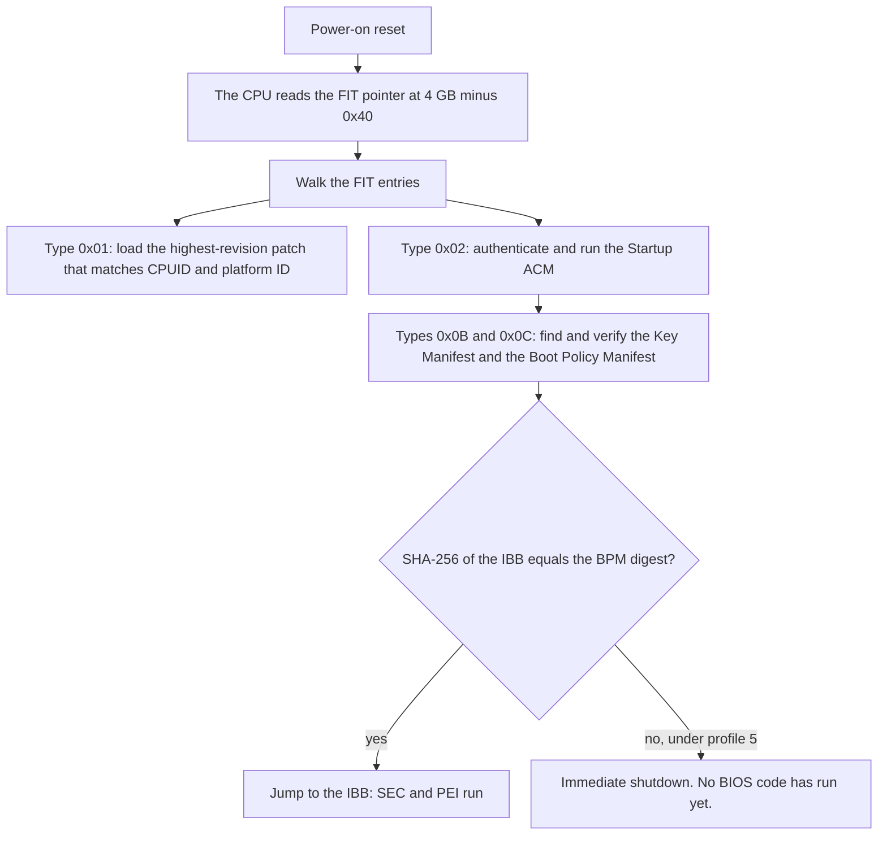
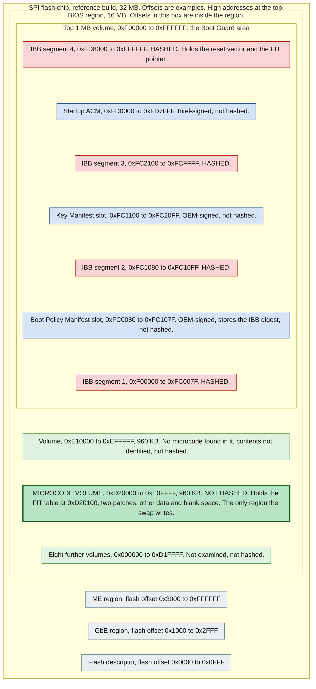

# How it works

Your board's BIOS carries a small library of Intel-signed microcode patches, one for each CPU stepping the vendor validated. This project adds one patch to that library, copied unchanged from the same vendor's newer BIOS, and leaves every byte that Intel Boot Guard checks exactly as it was.

This page follows the data: the patch, the chip it sits on, the table the CPU uses to find it, and the check that decides whether the machine may start. Each step ends in something you can verify on your own dump before you write anything.

Nothing on this page writes to a chip. The writing is in [04-procedure.md](04-procedure.md). The risks that come with it are in [05-safety-and-recovery.md](05-safety-and-recovery.md), which you should read before the procedure.

> **The claim.** Replacing one microcode patch with another of identical size, inside a volume that Boot Guard does not hash, leaves every input of the Boot Guard check unchanged, so the check has nothing new to fail on. On the reference build you can prove that offline. The pre-flash verifier in [`tools/`](../tools/) automates the proof.

## How to read the evidence

Every offset below comes from one board: a Dell OptiPlex 7060 SFF on BIOS 1.32.0, called the *reference build* throughout these docs. The offsets are examples. A different model, or a different BIOS version of the same model, moves them. [Section 9](#9-what-is-specific-to-the-reference-build) shows how to find yours. Terms are defined where they first appear and collected in [08-glossary.md](08-glossary.md).

Claims about the reference build and about outside sources carry one of four evidence words. This is the only place they are defined; the other pages link here.

| Word | Meaning |
|---|---|
| **verified on the reference build** (short form: **verified**) | Recomputed from the reference build's files (its pre-write dump, the payload, the modified image, the readback) or read from tool output. You can repeat it on yours. |
| **reported** | Recorded in the owner's notes at the time, or a live check over SSH that was not re-run. |
| **inferred** | Reasoning from the above. No source states it outright. |
| **unconfirmed** | A third-party claim (a forum post, a vendor page, a shop listing) that nobody here checked. The two words combine: "reported, unconfirmed" is a note whose console output or source document was not retained, or a claim that was reported to the owner and never checked. |

Three labels on this page are citations, not evidence words. `(spec, section N)` points at Intel's [Firmware Interface Table BIOS Specification](https://www.intel.pl/content/dam/develop/external/us/en/documents/firmware-interface-table-bios-specification-r1p2p1.pdf), document 599500, revision 1.2.1, October 2016. `(talk, ...)` points at a conference deck read in full, [Ermolov 2016](https://papers.put.as/papers/firmware/2016/Intel_BootGuard_final.pdf) or [Matrosov 2017](https://www.blackhat.com/docs/us-17/wednesday/us-17-Matrosov-Betraying-The-BIOS-Where-The-Guardians-Of-The-BIOS-Are-Failing.pdf), with slide numbers where the deck has them. `(page)` marks a quotation from a public project page (Intel's microcode README and release notes, the coreboot documentation) checked word for word on 2026-10-11. Forum posts are paraphrased, never quoted: none was read word for word.

## 1. What microcode is, and why a BIOS carries one per CPU

Part of a CPU's behaviour is implemented in microcode rather than fixed logic. Intel corrects errata and security problems after release by shipping a **microcode update**: a signed binary that the CPU loads into internal patch memory and applies at once. That memory is volatile. The patch is gone at power-off, so something has to load it again on every boot.

Two things can load it: the firmware, early, and the operating system, later. Intel's [microcode README](https://raw.githubusercontent.com/intel/Intel-Linux-Processor-Microcode-Data-Files/main/README.md) says "The preferred method to apply MCUs is using the system BIOS." and "Certain MCUs must only be applied from the BIOS." (page). If the BIOS refuses to start a CPU, no operating system ever runs to load a patch for it.

### How a patch is matched to a CPU

Two values tie a patch to a CPU.

- **Signature.** The value the `CPUID` instruction returns in `EAX`, which packs family, model and stepping (a stepping is a revision of the silicon design). `906EA` decodes to family 6, model 0x9E, stepping 0xA. Intel's repository names its patch files family-model-stepping, and the README's own worked example is `06-9e-0b`, which is `906EB` (page). By the same rule `906ED` is `06-9e-0d`.
- **Platform ID.** "Intel processors have a 3bit Platform ID field in MSR(17H)", and "The Platform ID(s) supported by an MCU is an 8bit mask where each set bit indicates a platform type that the MCU supports." (page; MSR is a model-specific register). The README adds that the ID can be read in Linux with `rdmsr`. The two patches in the reference BIOS carry masks `0x22` (IDs 1 and 5) and `0x02` (ID 1) (verified).

The desktop Coffee Lake parts this project is about use four signatures:

| CPUID | Stepping | Parts | In the reference BIOS? |
|---|---|---|---|
| `906EA` | U0 | 8th-gen 6-core | yes, revision 0xF8 (verified) |
| `906EB` | B0 | 8th-gen 4-core | yes, revision 0xF6 (verified) |
| `906EC` | P0 | the first 9th-gen 8-core stepping, plus engineering and qualification samples | no |
| `906ED` | R0 | retail 9th-gen parts of the R0 stepping, including the 8-core i7-9700T (SRG17) and i9-9900T (SRG1B) | no. This is the gap the project fills. |

Stepping letters and part examples are reported on [Win-Raid thread 34937](https://winraid.level1techs.com/t/help-adding-cpu-microcode-to-dell-7060-bios/34937) (unconfirmed).

Some 9th-gen i3 and i5 parts may reuse `906EA` or `906EB` (inferred; one poster in the bios-mods.com forum thread "Request: Bios upgrade of an HP Elitedesk 800 G4 mini to support i7 9700T" says an HP EliteDesk 800 G4 mini runs 9th-generation i5 CPUs but not 9th-generation i7, unconfirmed). Parts built on the R0 stepping need `906ED`. Look up your CPU's signature and check it against the list in your BIOS before assuming you need any change.

### What is inside a patch

A patch starts with a 48-byte header: header version, update revision, a BCD date, the CPU signature, a checksum, a loader revision, the platform mask, and the data and total sizes. The layout is defined in Intel's Software Developer's Manual, volume 3A, and parsing both reference patches with it gives sensible values (verified). The checksum rule is that every 32-bit word of the patch, header included, sums to zero modulo 2^32. Both reference patches satisfy it (verified).

The CPU checks a patch against an Intel key before applying it. Ermolov's slide 8 lists, among the CPU's root-of-trust contents, a "Hash of an RSA public key which verifies the microcode updates" (talk), and Matrosov's slide 24 says "The first step of verification should rely on microcode authentication" (talk). A hand-edited patch would therefore fail that check (inferred), so this project never edits one. It moves whole, unmodified patches and nothing else.

### Why the BIOS carries one per signature

Intel's FIT specification states the requirement flatly: "A microcode update must exist for every processor stepping supported by the platform" (spec, section 2.0). A patch is built for one signature, so a BIOS needs a separate patch for each stepping it wants to start. In practice, the set of patches a BIOS carries is the vendor's list of the CPUs it validated (inferred).

What a stock BIOS does when no patch matches the installed CPU is vendor code, and the evidence on it is thin. People add the missing patch because the board will not start the newer CPU without it (unconfirmed, Win-Raid thread 34937). The reference build's records show no test of the new CPU before the patch was written, so how the stock board fails is not documented here. After the change the board started, the CPU reported itself as `906ED`, and it has run that way since August 2026 (reported).

## 2. The flash chip

Everything the platform runs before the operating system sits on one SPI (serial peripheral interface) flash chip. A **flash descriptor** at the start of the chip divides it into regions. The reference build has a 32 MB chip with four of them (verified):

| Region | Flash offset | What it holds | Written by this method? |
|---|---|---|---|
| Descriptor | `0x000000` to `0x000FFF` | the region map, read and write permissions per region, chip parameters | no |
| GbE | `0x001000` to `0x002FFF` | network controller settings, including the MAC address | no |
| ME | `0x003000` to `0xFFFFFF` | firmware of the Management Engine, a separate microcontroller in the chipset that starts before the CPU cores | no |
| BIOS | `0x1000000` to `0x1FFFFFF` | UEFI firmware: boot code, drivers, setup, the variable store, microcode | one 960 KB volume inside it |

The BIOS region is last on the chip and is mapped to the top of the CPU's 4 GB address space. That is how the first instruction fetch after reset, at `0xFFFFFFF0`, reads the last bytes of the BIOS region.

The same byte has three addresses, and mixing them up is the commonest way to be off by a whole region:

| What | Offset in the BIOS region | Flash offset (what a flash tool takes) | CPU address |
|---|---|---|---|
| FIT table | `0xD20100` | `0x1D20100` | `0xFFD20100` |
| Swapped slot | `0xD3A000` | `0x1D3A000` | `0xFFD3A000` |
| Lowest hashed byte | `0xF00000` | `0x1F00000` | `0xFFF00000` |

Flash offset is the region base (`0x1000000` here) plus the region offset. CPU address is `0xFF000000` plus the region offset, because a 16 MB region ends at the 4 GB line.

Writing is a separate problem from layout, and a separate mechanism from Boot Guard. Write protection decides who may change the flash. Boot Guard decides whether what is stored there may run. Ermolov's slide 16 lists the layers as a hardware write-protect jumper, protected range (PR) registers, BLE, SMM_BWP, BIOS Guard and Boot Guard (talk). The descriptor gives each bus master read and write rights per region, and on the reference build the host may write the BIOS region (verified). Even so, a write attempt without the vendor's service jumper failed with "Error 167: Protected Range Registers are currently set by BIOS", which is the PR registers at work (reported). Lifting that lock is covered in [04-procedure.md](04-procedure.md). Nothing on this page depends on it.

## 3. The microcode volume and the FIT

### Firmware volumes

Inside the BIOS region, firmware is organised into **firmware volumes**: containers with a header (signature `_FVH`) and a declared length. The reference build's BIOS region is a chain of eleven of them, back to back from offset 0 to the end of the region, between 64 KB and about 6 MB each, with a 1 MB volume at the very top (verified). That top volume holds the initial boot block, which section 4 covers. The microcode lives in the ninth, at region offset `0xD20000`.

### What the microcode volume holds

| Region offset | In the volume | Content |
|---|---|---|
| `0xD20000` | `+0x0` | volume header, declared length `0xF0000` (960 KB) |
| `0xD20100` | `+0x100` | the FIT, 96 bytes |
| `0xD20400` | `+0x400` | patch `906EA`, `0x19C00` bytes, revision 0xF8 |
| `0xD3A000` | `+0x1A000` | patch `906EB`, `0x1A000` bytes, revision 0xF6, ending at `0xD54000` |
| after `0xD54000` | | blank space and a block of non-blank data of unknown purpose (it starts with the ASCII tag `MPDT`) that the swap does not touch |

The header is an ordinary volume header, and its declared length is exactly `0xF0000`. The contents do not follow the usual layout. A walk of the volume as a file system finds no files, because the first bytes after the header are blank (verified). The FIT and the patches are raw data at fixed offsets, so a tool that lists only files will not show them.

A byte scan of the whole BIOS region finds exactly two valid microcode patches, both in this volume (verified). The scan cannot see a copy inside a compressed section, so this says only that the two patches the FIT points at are the only ones in the image's uncompressed bytes.

### The FIT

The **Firmware Interface Table** is a short list in flash that the CPU reads itself. Intel's spec says "The CPU processes the FIT before executing the first BIOS instruction located at the reset vector (0FFFFFFF0h)." (spec, section 1.0).

The CPU finds the table through a pointer "located at the fixed address 4 GB - 40h (i.e., 0FFFFFFC0h)" (spec, section 3.1; Ermolov's slide 29 draws the same pointer at `0xFFFFFFC0`). On the reference build that is region offset `0xFFFFC0`, 64 bytes before the end of the region, and the 8 bytes there hold `0xFFD20100` (verified). The table starts with the eight bytes `_FIT_   ` (three trailing spaces) and continues in 16-byte entries (spec, Table 1):

| Field | Bytes |
|---|---|
| Address | 8 |
| Size, plus 1 reserved byte | 3 + 1 |
| Version | 2 |
| Type (low 7 bits) and a checksum-valid flag (top bit) | 1 |
| Checksum | 1 |

The first entry is the header. Its size field is the table's length in 16-byte units (spec, section 4.2), which here is 6, so 96 bytes. The reference table has six entries (verified):

| # | Type | Meaning | Points to |
|---|---|---|---|
| 0 | `0x00` | table header, size 6 | |
| 1 | `0x01` | microcode patch | `0xFFD20400` (region `0xD20400`) |
| 2 | `0x01` | microcode patch | `0xFFD3A000` (region `0xD3A000`) |
| 3 | `0x02` | Startup ACM | `0xFFFD0000` (region `0xFD0000`) |
| 4 | `0x0B` | Key Manifest | `0xFFFC1100` (region `0xFC1100`) |
| 5 | `0x0C` | Boot Policy Manifest | `0xFFFC0080` (region `0xFC0080`) |

The type numbers come from Table 2 of the spec, and the dump agrees with them: the type `0x0B` entry points at a structure tagged `__KEYM__`, the type `0x0C` entry at one tagged `__ACBP__` (verified). The spec requires that "The records must always be arranged in the ascending order of their type attribute in the FIT" (section 4.1) and that the Boot Policy Manifest entry "must follow the Key Manifest Entry (Type 0x0B)" (section 4.11). This table follows both (verified).

Some tables also carry a type `0x07` entry for a BIOS startup module. The spec says that type is for legacy TXT FIT boot and is not needed otherwise (section 4.6). This table has none, and its initial boot block is described by the Boot Policy Manifest alone (verified).

You can print your own table in a few lines. This reads the file and writes nothing:

```python
import struct

region = open("bios_region.bin", "rb").read()      # the BIOS region only, cut from a full dump
n = len(region)
fit = struct.unpack_from("<Q", region, n - 0x40)[0] - (0x100000000 - n)   # CPU address to region offset
assert region[fit:fit + 8] == b"_FIT_   ", "no FIT where the pointer says"

count = struct.unpack_from("<I", region, fit + 8)[0] & 0xFFFFFF
for i in range(1, count):
    addr, size, ver, typ, chk = struct.unpack_from("<QIHBB", region, fit + 16 * i)
    print(f"entry {i}: type 0x{typ & 0x7F:02X}  cpu address 0x{addr:X}  region offset 0x{addr - (0x100000000 - n):X}")
```

On the reference region it prints five lines, types `0x01`, `0x01`, `0x02`, `0x0B`, `0x0C`, with the addresses above.

Two details of the format carry most of the weight in the rest of this page.

1. **A microcode entry holds an address and nothing else.** The spec says the address "points to the first byte of the Microcode Update Header" and that "The Size field is not used. BIOS should clear this field to 0." (section 4.3, items 2 and 9). Both type `0x01` entries on the reference build have a size field of 0 (verified). The CPU reads the signature, platform mask and length from the patch header it finds at that address. What an entry points at can change without the entry changing.
2. **The pointer to the FIT is itself hashed by Boot Guard.** It sits inside the fourth IBB segment (verified, section 4). The table can be edited where it lies, but it cannot be moved without changing hashed bytes.

### How the CPU picks a patch

For each type `0x01` entry the CPU reads the header at the address and compares the signature and platform mask with its own. The spec's rules for what it finds there (section 4.3):

- "BIOS may have some empty Microcode Update slots", and an entry may point at one "as long as the first dword in the empty slot is 0xFFFF_FFFF." (item 4)
- When several patches match one signature and Platform ID, "The processor will load the latest available microcode update by choosing the one that has higher revision ID." (item 5)
- Patches are 16-byte aligned (item 6) and "must not be compressed, encoded or encrypted by the BIOS" (item 7).

Section 1.0 adds that a patch pointed to by a type `0x01` entry "is loaded before executing the BIOS code at the reset vector, and applied to all threads within the package", for the bootstrap processor (BSP), the core that runs the first instruction. The spec leaves model-specific loading detail to other documents. Firmware may also load microcode again later. How it finds patches at that stage is vendor code, and it was not examined here.

## 4. Intel Boot Guard

Boot Guard is Intel's hardware-rooted check on the first firmware the CPU executes. Two other names get mixed up with it. Intel BIOS Guard (PFAT) is a different mechanism, listed next to Boot Guard as a separate entry on Ermolov's slide 16 (talk). UEFI Secure Boot checks bootloaders and drivers later in boot, in the stage after Boot Guard hands over (talk, Matrosov slide 26).

### The chain

1. **Reset.** The CPU's built-in microcode starts and reads the FIT.
2. **ACM.** "If a valid type 2 entry is found, then that startup ACM is executed." (spec, section 1.0). The Startup **Authenticated Code Module** (ACM) is code signed by Intel, and it runs before any BIOS code.
3. **Manifests.** The ACM finds the **Key Manifest** (KM) and the **Boot Policy Manifest** (BPM) through FIT entries `0x0B` and `0x0C` (spec, sections 4.10 and 4.11). The chipset's Field Programmable Fuses (FPF) hold a hash of the OEM's root public key. The KM, signed with that key, carries the hash of the key that signs the BPM (talk, Ermolov slide 26).
4. **Digest.** The BPM lists the segments of the **Initial Boot Block** (IBB), the first BIOS code to run (the SEC and PEI phases, which set up the CPU and memory), and stores a SHA-256 digest of them (talk, Ermolov slides 26 and 43; the `IbbHash` field on slide 43 is commented "SHA256 of an IBB"). The ACM hashes those segments from flash and compares.
5. **Verdict.** On a match, control passes to the IBB. On a mismatch, the policy decides. Ermolov's slide 20 lists three: do nothing, shut down immediately, or shut down after a timeout of "e.g. 1 or 30 minutes".

The decks fix the order of these steps. The FIT spec says only that the CPU processes the table before the first BIOS instruction, that the microcode is loaded before the BIOS code at the reset vector, and that the startup ACM is executed if a valid type 2 entry is found. The diagram draws the microcode load and the ACM as two branches and does not claim an order between them.



### Modes and profiles

Boot Guard can measure, verify, or both. In **measured boot** the boot components are measured into TPM registers (PCRs) and the machine starts regardless: it records and does not enforce (talk, Ermolov slide 19). In **verified boot** the ACM checks the digest, and what a mismatch does depends on the enforcement field. The active combination comes from the chipset's fuses. The enforcement field has three values: `00b` do nothing, `01b` shut down after a timeout, `11b` shut down immediately (talk, Ermolov slide 23). Slide 24 names six profiles:

| Profile | Meaning |
|---|---|
| No_FVME | Boot Guard off |
| VE | verified, shut down after a timeout |
| VME | verified and measured, shut down after a timeout |
| VM | verified and measured, do nothing on failure |
| FVE | verified, shut down immediately |
| FVME | verified and measured, shut down immediately |

The letters read as force the ACM, verified, measured and enforcement (inferred; the deck does not spell them out). Forums number the six from 0 in this order, which makes "profile 5" FVME (inferred).

Under FVME the machine powers off the moment the digest fails, before any BIOS code has run, so there is no screen to show an error and nothing for a BIOS-level recovery to run on (inferred). The reference record expects a brief flicker, power-off and no display, and an external programmer on the chip as the only way back. Nobody triggered that on purpose, so it is the expected failure and not an observed one.

A poster in the Win-Raid thread for this board reports seeing profile 5 (FVME) set on the ME firmware side (unconfirmed, thread 34937, page 1). The reference board's fuses were not read. They live inside the Management Engine, "so only it can program and read them" (talk, Ermolov slide 21), which means a flash image alone cannot show them (inferred). Reading them takes a tool such as Intel's MEInfo on the running machine (reported). The method does not depend on the answer. It never changes a hashed byte, so the digest is the same under every profile.

Measured boot is separate from enforcement. A firmware change can alter TPM measurements, which matters if a secret such as a BitLocker key is sealed to them (talk, Ermolov slide 19 on sealing to PCR state). Whether later firmware stages measure the microcode volume is specific to each BIOS (inferred). Record your BitLocker state before writing; [05-safety-and-recovery.md](05-safety-and-recovery.md) covers it. The reference machine had BitLocker off (reported).

### What the reference build's IBB covers

The BPM lists four segments (verified). Together they are 984 KB, about 6 percent of the 16 MB region:

| Segment | Region offset | Length | Ends at |
|---|---|---|---|
| 1 | `0xF00000` | `0xC0080` | `0xFC0080` |
| 2 | `0xFC1080` | `0x80` | `0xFC1100` |
| 3 | `0xFC2100` | `0xDF00` | `0xFD0000` |
| 4 | `0xFD8000` | `0x28000` | `0x1000000` (end of region) |

SHA-256 over these four, in this order, equals the digest stored in the BPM, and no other order of the four does (verified; section 5 has the code). That match proves more than a pass: it proves the list is complete. Drop any one segment and the digest differs.

Nothing else in the region is hashed. The 15 MB below `0xF00000`, which holds most of the BIOS, is outside Boot Guard's hash. Whatever protects those stages belongs to the BIOS itself, such as the volume hashes some AMI-based BIOSes add (see the end of section 5).

## 5. Why a microcode edit cannot trip Boot Guard

The check has a fixed set of inputs: the FIT pointer and the FIT entries that locate the ACM and the manifests, the ACM, the KM, the BPM, the bytes of the IBB segments, and the fuses. If a change touches none of them, the ACM computes what it computed before. That is the whole argument. What remains is to show, board by board, that a microcode swap touches none of them.

On the reference build (verified):

| Object | Region offset | In the hash? |
|---|---|---|
| Microcode volume | `0xD20000` to `0xE0FFFF` | no |
| FIT table | `0xD20100` to `0xD2015F` | no |
| FIT pointer | `0xFFFFC0` | **yes**, inside IBB segment 4 |
| Startup ACM | `0xFD0000` to `0xFD7FFF` | no |
| Key Manifest | slot at `0xFC1100` | no |
| Boot Policy Manifest | slot at `0xFC0080` | no |
| SEC and PEI boot code | `0xF00000` to `0xFFFFFF`, minus the three holes above | yes |



Red boxes are hashed. Blue boxes are signed objects the hash leaves out. Green is outside the hash, and the dark green box is the volume the swap writes. The lowest hashed byte sits 960 KB above the end of the microcode volume. The offsets are the reference build's, for BIOS 1.32.0. Yours will differ.

### The pattern in the layout

The IBB has three holes: the BPM, the KM and the ACM. Each is a signed object. The BPM and KM carry the OEM's signature, which the ACM checks. The ACM carries Intel's, which the CPU checks. A digest cannot cover the manifest that stores it, and nothing needs to cover an object that authenticates itself. What the hash does cover is the OEM's own boot code, which nothing else vouches for.

Microcode fits the same description: Intel signs it and the CPU checks it (section 1). The verified layout is consistent with a simple rule, that objects which verify themselves sit outside the hash. That rule is inferred. None of the sources cited here says microcode is excluded on purpose. [coreboot's IBB page](https://doc.coreboot.org/security/intel/txt_ibb.html) says "The IBB might overlap with microcode." (page), which says overlap is possible and does not say it is required or forbidden. Coverage is a property of each vendor's BPM, not of Boot Guard. Compute it for your board and never assume it.

### Why the FIT table can sit outside the hash

The FIT is a list of pointers, and the objects it points to check themselves: microcode against an Intel key, the ACM against an Intel key, the KM and BPM against the OEM root key whose hash is fused (talk, Ermolov slides 8 and 26). A table that is absent or invalid is handled by the CPU, not by the hash: the spec says the behaviour "depends on platform provisioning and will range from immediate unbreakable shutdown and up to fallback to time-limited legacy boot followed by a platform reset" (section 3.1, rule 3). That the table can stay outside the hash for these reasons is inferred. That it does stay outside is verified.

One consequence matters for editing. The two FIT entries that lead to the manifests are not protected by the digest, because the table is not hashed, so a change to them would pass the digest check and still break the chain. Section 6 returns to this.

### The offline tests

Four checks decide whether a swap is safe on your board. Each reads only your files:

1. Parse the BPM and recompute the SHA-256 over its IBB segments. The result must equal the digest stored in the BPM. If it does not, your parse is incomplete or the layout differs from this generation's. Stop.
2. The microcode volume and the FIT table must not overlap any IBB segment. If either does, a swap changes hashed bytes, and a valid result would need the vendor's signing key. Stop.
3. After the swap, the FIT entries of types `0x0B` and `0x0C` must be bit-identical to the originals. The ACM locates the manifests through them (spec, sections 4.10 and 4.11), and the digest check would not notice an edit there. That a stale pointer fails the same way a changed IBB does is inferred from the verifier's rationale. It was not reproduced.
4. After the swap, the digest recomputed from the modified image must equal the stored digest.

This is the digest check in code. It reads a file and prints one line:

```python
import hashlib

region = open("bios_region.bin", "rb").read()      # the 16 MB BIOS region, not the whole chip

# From YOUR board's Boot Policy Manifest. These are the reference build's values (BIOS 1.32.0).
segments = [(0xF00000, 0xC0080), (0xFC1080, 0x80), (0xFC2100, 0xDF00), (0xFD8000, 0x28000)]
digest_at = 0xFC00F4                                # where this BPM stores its 32-byte digest

h = hashlib.sha256()
for offset, length in segments:                     # in the order the BPM lists them
    h.update(region[offset:offset + length])
print("IBB digest matches the digest stored in the BPM:", h.digest() == region[digest_at:digest_at + 32])
```

It prints `True` on the reference build's BIOS 1.32.0 region. You can see the point of this page on a copy of that file. Change one byte inside the `906EB` slot, at region offset `0xD3A010` for example, and it still prints `True`. Change one byte inside IBB segment 1, at `0xF00010` for example, and it prints `False` (verified on copies of the reference region; nothing was flashed). Reading the segment list out of the BPM is the part that varies by BPM version, and the snippet takes it as given. The BPM on this generation carries the tags `__ACBP__` (header), `__IBBS__` (the IBB element, with flags, digest and segment list) and `__PMSG__` (signature), and the KM carries `__KEYM__` (talk, Ermolov slides 39 to 45; offsets verified). Newer platforms use other manifest versions and may use other hash algorithms (inferred), so a mismatch on a newer board means stop, not adjust.

A malformed patch does not trip Boot Guard either. The CPU checks it against Intel's key and does not apply it if the check fails (inferred). That is a different failure, a new CPU that does not start, and the verifier's checksum gates exist to catch corruption before the write.

This project does not defeat Boot Guard and does not touch bytes it covers.

### A second check the offline tests cannot see

Some AMI-based BIOSes carry their own firmware-volume hash validation in PEI code. Matrosov's AMI slides show a `BootGuardPei` module with a "PEI FV_HASH" validation flow and an `FV_HASH_KEY` (talk, slides 53 to 56). If such a check covered the microcode volume, a swap would trip it instead of the ACM, and the failure would be whatever the vendor coded. The offline tests above do not reveal it.

On the reference build no such check fired. The board booted with the modified volume in place and has run since (reported). On any other board that has to be established by booting, which is why the procedure puts a boot on the old CPU before the CPU swap ([04-procedure.md](04-procedure.md), Phase 5).

## 6. The same-size slot swap

The change is one move: overwrite an existing microcode slot with a different patch of exactly the same total size, and write nothing else. The write window is that one volume, `0xF0000` bytes at flash offset `0x1D20000` (`0x1000000` plus `0xD20000`). The window ends 960 KB below the lowest hashed byte (verified), so a wrong payload still cannot change a hashed byte.

On the reference build:

| | Before | After |
|---|---|---|
| FIT table | six entries, 96 bytes | byte-identical |
| Slot 1, `0xD20400`, `0x19C00` bytes | `906EA`, revision 0xF8 | untouched |
| Slot 2, `0xD3A000`, `0x1A000` bytes | `906EB`, revision 0xF6 | `906ED`, revision 0x104, also `0x1A000` bytes (taken from the vendor's OptiPlex 7070 BIOS 1.35.0) |
| Rest of the 960 KB volume, other data and blank space included | | byte-identical |
| IBB, ACM, KM, BPM | | byte-identical |

Both columns are verified except where the donor came from: they were recomputed from the reference build's pre-write dump and from the payload and modified image that were written (the verifier's August output was not retained). That the 906ED patch came from the vendor's OptiPlex 7070 BIOS 1.35.0 is reported. The bytes that differ lie between `0xD3A004` and `0xD53FFF`, 105,698 of them (verified). The first changed byte is at `+4` of the slot, so the first four bytes, the header version, hold the same value in both patches (inferred from the range).

### Why a byte-identical FIT is the safest edit

- **Nothing the CPU follows moves.** Every pointer, count and type in the table stays as the CPU and the ACM expect, including the two entries that lead to the manifests.
- **The spec treats the table as load-bearing.** With Boot Guard the FIT "is no longer optional element of architecture", and an absent or invalid one can mean an immediate shutdown (section 3.1, rule 3, quoted in section 5). An edit that leaves the table byte-identical cannot make it invalid.
- **Nothing needs recomputing or re-sorting.** No size field, count or ordering rule is touched.
- **One comparison proves it.** "FIT unchanged" is a yes or no answer.
- **The alternative is a bigger edit.** Appending an entry grows the table and changes its size. The entries must stay in ascending type order (spec, section 4.1), the table must not run into the first patch (672 bytes of room on the reference build), and the KM and BPM entries must stay bit-identical. A post on this BIOS family warns that adding microcodes, or changing the size of either original in slot 1 or 2, may make the microcode fail to load unless the whole BIOS region is edited and reflashed with FPT (unconfirmed, Win-Raid thread 34937, page 3). The poster's remedy is a much larger write than this project makes. It can be done by hand, but it has more ways to go wrong. Treat it as expert-only and use it only when no slot of the right size exists.

The project requires an exact size match. A larger patch would overrun the next slot. The FIT stores no size for a patch, so why a resize would fail to load is not established here, and the exact-size rule avoids the question.

### What the swap costs

The slot's previous patch is gone. On the reference build that is `906EB`, which serves 8th-generation 4-core parts. A CPU with that signature would no longer find a patch in this BIOS (inferred: it is the missing-patch case from section 1, and untested). So "unused slot" means more than a free one. The slot must not belong to your resident CPU, and not to any CPU you might want to fall back to. If no spare slot has the right size, do not improvise.

### What gets moved

Only a whole, unmodified patch from the same vendor's own newer BIOS. Before using any patch, check three things with MCExtractor: the signature is your CPU's, the platform mask has the bit for your CPU's platform ID, and the checksum rule from section 1 holds. You can read a platform ID with `rdmsr` on a machine that already runs the same CPU (page, Intel README). A patch taken from a board that officially ships your CPU should already carry the right mask (inferred).

As a cross-check, the donor patch in the reference build carries revision 0x104 (reported), and Intel's [release notes](https://raw.githubusercontent.com/intel/Intel-Linux-Processor-Microcode-Data-Files/main/releasenote.md) list `06-9e-0d/22` going from `00000102` to `00000104` in release microcode-20250512 (page). Intel's row names the product "Core Gen9 Mobile", so read it as confirming the revision and not as a statement about your part. Whether a vendor's BIOS accepts a patch taken from Intel's repository is unproven. Where patches come from, and the licence terms attached to them, are in [09-sourcing-and-licensing.md](09-sourcing-and-licensing.md).

### How much of this needs hands

On the reference build the owner read the CPU lid, moved the service jumper on and off, swapped the CPU and thermal pad, and removed the case mesh screens; everything else was done remotely over SSH by an AI agent. That includes the dumps, the parsing, the payload build, the verification, the write and the readback (reported).

## 7. Why the old CPU keeps working

A CPU looks for a patch whose signature and platform mask match its own (section 3; spec, section 4.3, item 5). Patches for other signatures are never candidates for it, so adding or replacing the `906ED` slot cannot change what a `906EA` CPU finds. Its patch stays in its slot, and its FIT entry never changes. The changed range above lies entirely inside slot 2, so `906EA`'s bytes are identical before and after. Intel's spec is built around this arrangement: a BIOS "may carry multiple Microcode Updates for multiple processor stepping support", each at its own entry (section 4.3, item 2).

If the new CPU fails for a reason of its own, whether a wrong stepping, an engineering sample, an unsuitable platform mask or a thermal limit, the old CPU's side of the BIOS is byte-identical to what it was, so it should start again once you put it back. That is an argument from the bytes. The reference build did not test it, as section 10 notes.

That argument is structural, and it has two limits.

- **It assumes the write completed.** The write covers the whole 960 KB volume, FIT included, even though the final bytes there are identical. A power cut mid-write, or a failed write that goes unnoticed, can leave the board unable to start with either CPU (inferred; the reference record lists it as an accepted risk). That is why the procedure reads the range back and compares it, and why [05-safety-and-recovery.md](05-safety-and-recovery.md) wants an external programmer on hand before the first write.
- **It is a property of this BIOS image.** Any vendor BIOS update, downgrade or recovery rewrites the stock volume and removes the new patch with it. After that the new CPU will not start the board until you repeat the swap (inferred; it follows from what the flash holds).

Engineering and qualification samples are a documented case where a new CPU fails for its own reasons. A `906EC` (P0) part is reported not to start on this BIOS family even with the patch. A poster who builds these patches wrote that the BIOS blocks every CPU of stepping P0 (CPUID 0x906EC) and that the check sits in a hashed volume protected by Boot Guard (unconfirmed, Win-Raid thread 34937, page 4). The reference record repeats the claim and did not test it. If that report is right, the code cannot be edited under Boot Guard, so there is no workaround here. Read the markings on the CPU's lid before you buy.

## 8. Where this argument stops

The argument holds for a Coffee Lake-era Boot Guard layout whose microcode volume and FIT lie outside the hash. These cases fall outside it:

| You find | What it means | What to do |
|---|---|---|
| The digest does not recompute | Your parse of the BPM is incomplete, or the manifest layout differs. Platforms newer than this generation use other manifest versions (inferred). | Stop. Do not guess. |
| The microcode volume or FIT overlaps an IBB segment | A swap changes hashed bytes. | Stop. A valid edit would need the vendor's signing key. |
| No spare slot of the right size | A swap is impossible, and an append edits the table. | Expert-only. [02-does-my-hardware-qualify.md](02-does-my-hardware-qualify.md) has the decision tree. |
| A vendor volume-hash check covers the microcode volume | The failure mode is the vendor's own and is not visible offline. It would hit with either CPU, because the volume is modified. | Boot the old CPU first. Recovery is then the board-level path in [05-safety-and-recovery.md](05-safety-and-recovery.md). |
| Boot Guard is not enforced on your board | The hash constraint relaxes, but the vendor's own checks may remain (inferred). | Run the same tests anyway. |
| The platform restores flash from a protected copy | Reported for HP Sure Start: it restores a stock BIOS on reboot, even after a modified one is programmed in (a post about an HP laptop, unconfirmed, Win-Raid thread 35122). | Out of scope. Do not assume the recovery steps hold. |
| The write lock cannot be lifted | The method needs a write path first. | External programmer only. See [04-procedure.md](04-procedure.md). |
| A prebuilt patch made for another BIOS version | Prebuilt patches made for an early BIOS of the reference model, flashed onto later versions, left boards that would not start (unconfirmed, Win-Raid thread 34937, pages 7 and 8). The patch author warns in the thread not to use the mod on any other BIOS version and says the Boot Policy address changed in newer versions. The mechanism is unconfirmed. The reported symptom is amber blinking, which differs from the power-off the reference notes expect from a Boot Guard shutdown, so stale FIT pointers to the manifests are one explanation among several (inferred). | Build from your own dump, never from someone else's blob. |

One more reason offsets do not transfer. A 2020 forum post says that writing this same range (`0x1D20000`, length `0xF0000`) would overwrite the entire FIT table and the BIOS ACM that follows the microcode (unconfirmed, Win-Raid thread 34937, page 3). On BIOS 1.32.0 the FIT table is inside the volume, as the post says, but the startup ACM is at region offset `0xFD0000`, outside it (verified). Either the module the post means is something else, or the layout changed between versions.

## 9. What is specific to the reference build

| Item | Reference build, BIOS 1.32.0 | How to find yours |
|---|---|---|
| BIOS region base on the chip | `0x1000000` | the region map in the descriptor, which the flash tool's info command prints |
| BIOS region length | 16 MB | the same map |
| FIT pointer | 8 bytes at region offset `0xFFFFC0`, value `0xFFD20100` | the 8 bytes 64 below the end of the region |
| FIT table | region `0xD20100`, six entries | follow the pointer and check for `_FIT_   ` (snippet in section 3) |
| Microcode patches | `0xD20400` (`906EA`), `0xD3A000` (`906EB`) | FIT type `0x01` entries, or `python MCE.py bios_region.bin` |
| Microcode volume | `0xD20000`, length `0xF0000` | the volume that contains those addresses |
| Startup ACM | `0xFD0000`, `0x8000` bytes | FIT type `0x02` |
| Key Manifest, Boot Policy Manifest | `0xFC1100`, `0xFC0080` | FIT types `0x0B` and `0x0C`; tags `__KEYM__` and `__ACBP__` |
| IBB segments | four, listed in section 4 | the IBB element of your BPM; prove the list by recomputing the digest |
| Slot swapped | `906EB`, `0x1A000` bytes | a slot whose signature you do not need, with the same total size as the donor patch |

Two tools help you look. Neither writes to the chip.

- **MCExtractor** ([platomav/MCExtractor](https://github.com/platomav/MCExtractor)): `python MCE.py bios_region.bin` lists every patch in an image with CPUID, platform, revision, date, size and checksum status. The [Win-Raid usage thread](https://winraid.level1techs.com/t/how-to-extract-a-list-of-supported-cpus-from-a-bios/32414) uses it to check whether a CPUID is present at all.
- **UEFITool NE** ([LongSoft/UEFITool](https://github.com/LongSoft/UEFITool)): shows the volumes, the FIT and the patches. Recent builds colour the ranges they believe Boot Guard protects, and Win-Raid users treat uncoloured ranges as editable (unconfirmed). Take the colouring as a hint and the digest check as the test.

## 10. What is not established

- **The reference board's Boot Guard profile.** Profile 5 is reported on a forum, not read from the fuses or the BPM flags.
- **Why microcode sits outside the IBB.** The layout fits a rule, but no document states it as design intent, and coreboot's wording allows overlap.
- **How the stock BIOS fails with an unmatched CPU.** The reference build's records show no test of the new CPU before the patch, so the mechanism behind "the board will not start it" is reported, not verified.
- **The old-CPU fallback.** Section 7 argues it from the bytes. The reference record does not show a boot on the old CPU between the write and the CPU swap.
- **Which later firmware stage reloads microcode.** The FIT load covers the bootstrap processor and, per the spec, all threads in the package. Whether and how the BIOS loads patches again was not examined.
- **Manifest formats newer than Coffee Lake.** Only this generation's BPM was parsed. Digest algorithm and layout may differ elsewhere.
- **Other BIOS versions of the reference model.** Only 1.32.0 was dumped and analysed.
- **Compressed copies of microcode.** A byte scan cannot see inside compressed sections.
- **TPM measurements.** Whether a given BIOS measures the microcode volume, and what that does to a sealed secret, is firmware-specific and was not tested.
- **Intel's public repository as a donor.** Whether a vendor's CPU check accepts a patch from there is unproven.

## 11. Sources

Specifications and talks:

- Intel, *Firmware Interface Table BIOS Specification*, document 599500, revision 1.2.1, October 2016: [PDF](https://www.intel.pl/content/dam/develop/external/us/en/documents/firmware-interface-table-bios-specification-r1p2p1.pdf). Sections 1.0, 2.0, 3.1, 4.1, 4.2, 4.3, 4.6, 4.10, 4.11 and Table 2 are used above.
- Ermolov, *Safeguarding rootkits: Intel BootGuard*, ZeroNights 2016: [PDF](https://papers.put.as/papers/firmware/2016/Intel_BootGuard_final.pdf).
- Matrosov, *Betraying the BIOS: Where the Guardians of the BIOS Are Failing*, Black Hat USA 2017: [PDF](https://www.blackhat.com/docs/us-17/wednesday/us-17-Matrosov-Betraying-The-BIOS-Where-The-Guardians-Of-The-BIOS-Are-Failing.pdf).
- coreboot, Intel TXT Initial Boot Block: [doc.coreboot.org/security/intel/txt_ibb.html](https://doc.coreboot.org/security/intel/txt_ibb.html).
- Intel, microcode data files: [README](https://raw.githubusercontent.com/intel/Intel-Linux-Processor-Microcode-Data-Files/main/README.md), [release notes](https://raw.githubusercontent.com/intel/Intel-Linux-Processor-Microcode-Data-Files/main/releasenote.md) and [licence](https://raw.githubusercontent.com/intel/Intel-Linux-Processor-Microcode-Data-Files/main/license).

Tools and community threads:

- [MCExtractor](https://github.com/platomav/MCExtractor) and [UEFITool](https://github.com/LongSoft/UEFITool).
- Win-Raid, [Adding CPU Microcode to Dell 7060 BIOS](https://winraid.level1techs.com/t/help-adding-cpu-microcode-to-dell-7060-bios/34937) (originally titled "Help adding CPU Microcode to Dell 7060 BIOS?"), thread 34937, April 2020 onward. Pages are the thread's own `?page=N` pages.
- Win-Raid, [Rollback HP Elite Dragonfly BIOS and Intel ME](https://winraid.level1techs.com/t/rollback-hp-elite-dragonfly-bios-and-intel-me/35122), thread 35122.
- bios-mods.com forum thread "Request: Bios upgrade of an HP Elitedesk 800 G4 mini to support i7 9700T" (no stable short link; search the forum by title).
- Win-Raid, [How to extract a list of supported CPUs from a BIOS](https://winraid.level1techs.com/t/how-to-extract-a-list-of-supported-cpus-from-a-bios/32414).
